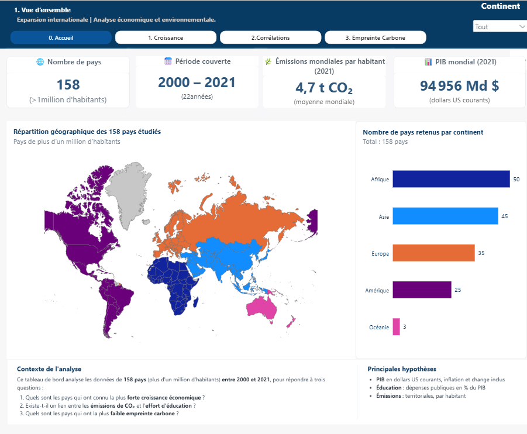
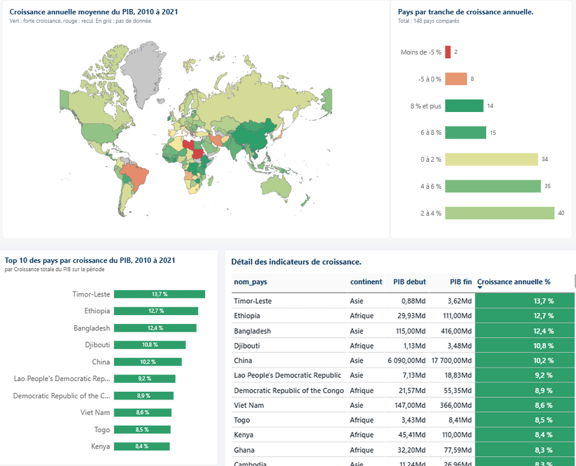
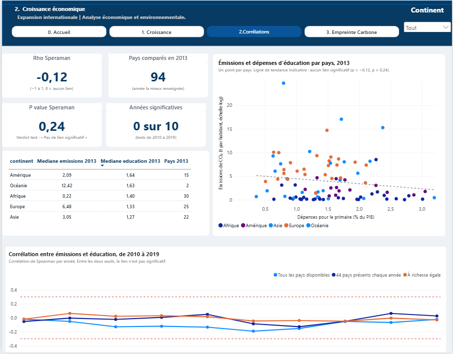
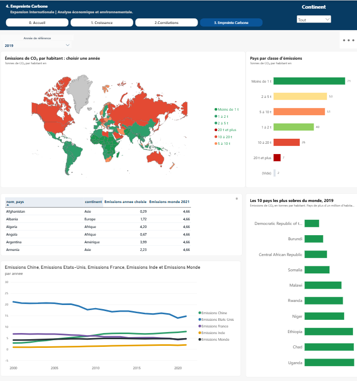

# Choisir une nouvelle zone d'implantation

**Test technique Equancy** | Abdoulaye Diop | Octobre 2026

Croissance économique, émissions de CO₂ et éducation dans 158 pays, de 2000 à 2021.



## Le contexte

Une entreprise internationale cherche une nouvelle zone géographique pour s'implanter. Sa direction logistique veut s'appuyer sur des données publiques pour répondre à trois questions :

| | Question |
|---|---|
| **a** | Quels pays ont connu la plus forte croissance du PIB entre deux années données ? |
| **b** | Quelle est la corrélation entre les émissions de CO₂ et le niveau d'éducation dans différents pays ? |
| **c** | Quels pays ont la plus faible empreinte carbone par habitant, et comment cela évolue-t-il au fil des années ? |

## Les réponses en bref

| | Réponse |
|---|---|
| **a** | Entre 2010 et 2021, le Timor-Leste, l'Éthiopie, le Bangladesh, Djibouti et la Chine ont la plus forte croissance, avec plus de 10 % par an. La croissance se concentre en Asie et en Afrique. |
| **b** | Aucun lien entre les émissions de CO₂ et les dépenses d'éducation. Le résultat est le même chaque année de 2010 à 2019, et à niveau de richesse égal. |
| **c** | Les dix pays les plus sobres sont tous africains, avec la RD Congo en tête (0,03 t par habitant en 2019). Ce classement est stable depuis 2000. |
| **Synthèse** | L'Afrique de l'Est (Éthiopie, Kenya, Tanzanie) et l'Asie du Sud (Bangladesh) combinent forte croissance et faible empreinte carbone. |

## Contenu du projet

```
PROJET EQUANCY/
├── README.md
├── requirements.txt                        bibliothèques Python à installer
├── traitement de donnes.ipynb              étape 1 : préparation des données et modèle
├── analyse_donneesequancy.ipynb            étape 2 : analyse et tests statistiques
├── Projet Equancy Diop  Abdoulaye.pbix     étape 3 : tableau de bord Power BI
├── images/                                 captures du tableau de bord utilisées dans ce README
└── data/
    ├── raw/          les 6 fichiers fournis, jamais modifiés
    ├── reference/    table des continents par code pays
    ├── processed/    les fichiers nettoyés, un par source
    ├── mart/         le modèle en étoile lu par l'analyse et par Power BI
    └── resultats/    les résultats des tests, calculés dans l'analyse pour Power BI
```

## Les données

Six fichiers publics ont été fournis :

| Fichier | Ce qu'il contient | Années utiles |
|---|---|---|
| Emissions per country | Émissions de CO₂ par habitant, par pays | 1950 à 2021 |
| GDP Unesco_fullvalue | PIB en dollars US courants | 2000 à 2021 |
| Population (thousands) | Population, en milliers d'habitants | 2000 à 2021 |
| Demographic indicators | Espérance de vie, part de population rurale | 2010 à 2021 |
| Governement_Expenditure_education | Dépenses publiques pour le primaire, en % du PIB | 2010 à 2022 |
| Expenditure_preservation&conservation | Dépenses de préservation du patrimoine | 2017 à 2022 |

La période d'étude est celle du PIB : **de 2000 à 2021**.

## La démarche

Le projet suit quatre étapes. Chacune garde ses fichiers dans un dossier séparé, ce qui permet de tout refaire à partir des fichiers d'origine.

```
 Données brutes   →   Préparation   →   Modèle en étoile   →   Analyse et tableau de bord
   data/raw          data/processed        data/mart            notebook + Power BI
```

### Étape 1 : préparer les données

Notebook `traitement de donnes.ipynb`.

Chaque fichier passe par le même déroulé :

1. **Lecture et contrôle des types** : on vérifie que les nombres sont bien lus comme des nombres.
2. **Exploration** : valeurs manquantes, doublons, années couvertes, valeurs extrêmes.
3. **Détection des anomalies** : codes pays incohérents, années absentes, valeurs aberrantes.
4. **Correction** : par exemple, les trous courts dans une série sont comblés par interpolation.
5. **Tests de qualité et sauvegarde** : des règles automatiques bloquent la suite si une donnée reste incorrecte. Le fichier propre est ensuite enregistré dans `data/processed`.

Les fonctions communes à tous les fichiers sont regroupées au début du notebook (partie 0). Les parties 1 à 6 traitent un fichier chacune.

### Étape 2 : construire le modèle

Partie 7 du même notebook. Les six fichiers ont tous une ligne par pays et par année. Ils sont donc réunis dans une seule table de faits, entourée de deux tables qui décrivent les pays et les années :

```
                     dim_pays
              code_iso, nom_pays, continent,
              type_entite, plus_d_un_million
                         │
                         │
          fait_indicateurs_pays_annee
          une ligne par pays et par année :
          emissions_t_hab, pib_usd, population_milliers,
          esperance_vie, population_rurale_pct,
          depenses_education_pct_pib, depenses_patrimoine_par_hab
                         │
                         │
                     dim_annee
                  annee, decennie
```

Le modèle contient 235 pays et territoires, plus la ligne Monde, sur 22 années. Sept règles vérifient sa cohérence : clés uniques, chaque pays de la table de faits existe dans `dim_pays`, chaque pays a un nom et un continent, etc.

### Étape 3 : analyser

Notebook `analyse_donneesequancy.ipynb`. Il lit le modèle avec **DuckDB**, qui permet d'interroger les fichiers CSV en SQL, puis répond aux questions dans l'ordre :

| Partie | Contenu |
|---|---|
| 0 | Configuration et fonctions, regroupées par question |
| 1 | Question a : croissance du PIB |
| 2 | Les émissions de CO₂ dans le temps, base commune aux questions b et c |
| 3 | Question b : émissions et éducation, avec les tests statistiques |
| 4 | Question c : pays à la plus faible empreinte carbone |
| 5 | Synthèse : croiser croissance et empreinte carbone |

Chaque partie suit la même logique : la méthode expliquée simplement, le calcul, puis un commentaire qui donne les chiffres et leur sens. Les tests statistiques, difficiles à faire dans Power BI, sont calculés ici et exportés dans `data/resultats`.

### Étape 4 : présenter

Le tableau de bord Power BI reprend les résultats sur quatre pages : Accueil, Croissance, Corrélations, Empreinte carbone. Un filtre par continent est disponible sur toutes les pages.

## Les hypothèses

| Hypothèse | Pourquoi | Effet sur la lecture |
|---|---|---|
| Pays de plus d'un million d'habitants | Les très petits pays ont des valeurs par habitant instables et ne sont pas des marchés pertinents | 158 pays sont retenus |
| PIB en dollars US courants | C'est la seule mesure du PIB disponible | Les variations incluent l'inflation et les effets de change |
| Émissions territoriales par habitant | C'est la mesure fournie par la source | Les émissions contenues dans les produits importés ne sont pas comptées |
| Éducation mesurée par les dépenses publiques pour le primaire | Aucun indicateur de niveau d'éducation atteint n'est disponible | On mesure un effort budgétaire, pas un résultat |
| La ligne Monde comme référence | Elle permet de situer chaque pays | Les pays se lisent en multiple de la moyenne mondiale |

## Question a : la croissance du PIB



**Méthode.** On compare le PIB de chaque pays entre 2010 et 2021. On part de 2010 pour éviter 2009, faussée par la crise financière, et 2021 est la dernière année disponible. La croissance est mesurée de trois façons :

- la **croissance totale** : de combien le PIB a augmenté sur la période ;
- la **croissance annuelle moyenne** : le même calcul ramené à un rythme par an, pour comparer des périodes de longueurs différentes ;
- la **croissance par habitant** : pour vérifier que la hausse ne vient pas seulement de la hausse de la population.

Dans le tableau de bord, les années de début et de fin peuvent être modifiées.

**Résultats.**

- 148 pays sont comparés. Les dix plus fortes croissances sont toutes en Asie et en Afrique.
- Le Timor-Leste arrive en tête avec 13,7 % par an, devant l'Éthiopie (12,7 %), le Bangladesh (12,4 %), Djibouti (10,8 %) et la Chine (10,2 %).
- La croissance annuelle médiane est de 3,7 %. Quatorze pays dépassent 8 % par an et dix pays reculent.
- L'Europe est le continent le plus lent, avec une médiane de 2,3 % par an.

## Les émissions de CO₂ dans le temps

Cette partie sert de base aux questions b et c.

- Les émissions mondiales passent de 4,1 t par habitant en 2000 à 4,85 t en 2012, puis se stabilisent autour de 4,7 t.
- Ce plateau cache des évolutions opposées : l'Amérique et l'Europe baissent, l'Asie passe de 2,4 t à 4,5 t, et l'Afrique reste autour de 1,1 t.
- Les pays se rapprochent. En 2000, les pays les plus émetteurs émettaient 119 fois plus que les plus sobres, contre 45 fois en 2019.

## Question b : émissions de CO₂ et éducation



**Méthode.** On compare les pays entre eux, une année à la fois, pour que chaque pays ne compte qu'une fois.

1. **Choix de l'année.** Les dépenses d'éducation ne sont disponibles qu'à partir de 2010, et pas pour tous les pays. On retient **2013**, l'année la mieux renseignée, avec 94 pays.
2. **Test principal : la corrélation de Spearman.** Elle indique si les pays qui dépensent le plus pour l'éducation sont aussi ceux qui émettent le plus, ou le moins. Elle va de −1 à +1 et vaut 0 en l'absence de lien. Elle compare les rangs des pays plutôt que leurs valeurs, ce qui évite qu'un petit nombre de très gros émetteurs fausse le résultat.
3. **Test du Khi².** Il cherche un lien de n'importe quelle forme, par exemple en cloche, que Spearman ne verrait pas.
4. **Robustesse.** On refait le test chaque année de 2010 à 2019, sur tous les pays disponibles, puis sur les 44 pays présents chaque année.
5. **À richesse égale.** On vérifie qu'un lien n'est pas masqué par le niveau de vie des pays.

Pour chaque test, on part de l'hypothèse qu'il n'y a aucun lien. On ne parle de lien que si la p-value est inférieure à 5 %.

**Résultats.**

| Test | Résultat | p-value | Lien ? |
|---|---|---|---|
| Spearman, 2013 | −0,12 | 0,24 | Non |
| Khi², 2013 | 13,8 | 0,13 | Non |
| Spearman à richesse égale, 2013 | +0,03 | 0,78 | Non |
| Spearman, chaque année de 2010 à 2019 | entre −0,19 et −0,02 | toutes au-dessus de 0,05 | Non, aucune année |

Avec 95 % de confiance, la corrélation réelle se situe entre −0,32 et +0,10 : un lien modéré ou fort est exclu.

**Réponse.** Les données ne montrent aucun lien entre les émissions de CO₂ et les dépenses d'éducation. Pour le choix d'une implantation, ces deux critères doivent donc être étudiés séparément.

## Question c : la plus faible empreinte carbone



**Méthode.**

1. **Classement en 2019**, dernière année avant la crise sanitaire, vérifié sur 2021.
2. **Stabilité** : pour chaque pays, on compte le nombre d'années où il figure parmi les dix plus sobres, de 2000 à 2021.
3. **Évolution** : on compare les émissions de 2019 à celles de 2000.
4. **Par continent** : on cherche aussi les pays les plus sobres de chaque continent, pour ne pas regarder que l'Afrique.

**Résultats.**

- Les dix pays les plus sobres sont tous africains. Un habitant de la RD Congo émet 0,03 t de CO₂, environ 160 fois moins que la moyenne mondiale (4,7 t).
- Six pays figurent parmi les dix plus sobres chaque année depuis 2000 : RD Congo, Burundi, Somalie, Niger, Centrafrique et Rwanda.
- Huit de ces dix pays augmentent leurs émissions depuis 2000, mais à partir de niveaux très bas. L'Ouganda, par exemple, passe de 0,06 t à 0,14 t par habitant.
- Hors d'Afrique, les plus sobres sont Haïti (0,27 t) en Amérique, l'Afghanistan (0,29 t) en Asie et l'Albanie (1,7 t) en Europe.

**Réponse.** La RD Congo, la Somalie et la Centrafrique ont la plus faible empreinte carbone, sous 0,05 t par habitant. Ce classement est stable depuis 2000. Cette faible empreinte reflète surtout un faible développement économique.

## Synthèse : croiser croissance et empreinte carbone

Les pays les plus sobres sont aussi les moins développés, ce qui en fait rarement des cibles d'implantation. On croise donc les deux critères pour les vingt pays à plus forte croissance. Dix-sept d'entre eux émettent moins que la moyenne mondiale. Trois profils apparaissent :

| Profil | Pays | Croissance par an | Émissions, en % de la moyenne mondiale |
|---|---|---|---|
| Croissance forte, empreinte très faible | Éthiopie, Bangladesh, Kenya, Ghana, Tanzanie, Guatemala | 7 à 13 % | 3 à 24 % |
| Croissance forte, empreinte en hausse rapide | Viet Nam, Laos, Cambodge | 8 à 9 % | 23 à 75 % |
| Croissance forte, empreinte déjà élevée | Chine, Mongolie | 7 à 10 % | 157 à 309 % |

**Recommandation.** Le premier profil est le plus intéressant, avec deux zones : **l'Afrique de l'Est** (Éthiopie, Kenya, Tanzanie) et **l'Asie du Sud** (Bangladesh). Cette présélection doit être confirmée par des critères absents des données : infrastructures logistiques, stabilité politique, taille du marché, coût de la main-d'œuvre, accès à une énergie bas carbone.

## Les limites

- **Le PIB est en dollars courants.** Une partie des écarts vient de l'inflation et des taux de change, comme pour le Brésil ou l'Iran.
- **L'éducation est mesurée par une dépense,** limitée au primaire et renseignée pour environ 90 pays par an.
- **Les émissions sont territoriales.** Un pays qui importe ses produits industriels paraît plus sobre qu'il ne l'est.
- **Quelques populations manquent,** dont celles des États-Unis, de la France et du Japon en 2021.

## Lancer le projet

Prérequis : Python 3.11 ou plus récent, et Power BI Desktop pour ouvrir le tableau de bord.

1. Ouvrir un terminal dans le dossier du projet, puis créer et activer un environnement Python :
   ```bash
   python -m venv .venv
   .venv\Scripts\activate          # sous Windows
   source .venv/bin/activate       # sous macOS ou Linux
   ```
2. Installer les bibliothèques :
   ```bash
   pip install -r requirements.txt
   ```
3. Lancer Jupyter :
   ```bash
   jupyter notebook
   ```
4. Exécuter les notebooks dans cet ordre :
   1. `traitement de donnes.ipynb` : produit `data/processed` et le modèle de `data/mart` ;
   2. `analyse_donneesequancy.ipynb` : produit les résultats de `data/resultats`.
5. Ouvrir `Projet Equancy Diop  Abdoulaye.pbix` dans Power BI Desktop. Si les fichiers ont été déplacés, mettre à jour le chemin des sources dans **Transformer les données**, puis **Paramètres de la source de données**.

## Outils utilisés

| Outil | Rôle |
|---|---|
| Python, pandas | Lecture, nettoyage et préparation des données |
| DuckDB | Requêtes SQL sur les fichiers du modèle |
| SciPy | Tests statistiques |
| Matplotlib | Graphiques des notebooks |
| Power BI | Tableau de bord |
